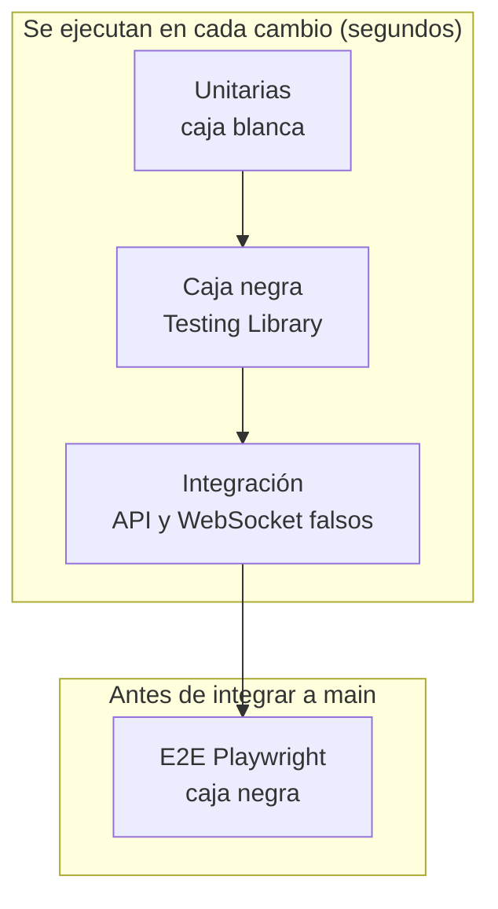

# Plan de pruebas — frontend

| Campo | Valor |
|-------|-------|
| Sistema | Plataforma de gestión y optimización de un robot seguidor de línea velocista (APAEC Lab) |
| Componente | `velocista-frontend` (consola web) |
| Responsable de pruebas | Tatiana Priscila Espejo Loyaga |
| Última actualización | 16 oct 2026 |

## 1. Objetivo y alcance

Garantizar que la consola muestra y envía correctamente la información del sistema: catálogo,
armador, reglamento, control del robot, telemetría, mapa, corridas y estado de conexión, y que respeta
el contrato de la API (campos en inglés, textos en español para el usuario).

**Dentro del alcance:** lógica de dominio del cliente, componentes comunes, páginas, capa HTTP, estado global, WebSocket de consola, flujos en navegador.
**Fuera del alcance:** el backend real (se simula), el firmware, pruebas de rendimiento y de compatibilidad con navegadores distintos de Chromium.

## 2. Estrategia

| Decisión | Motivo |
|----------|--------|
| Caja negra en `black-box` y `e2e` | requisito del profesor; resiste refactors internos |
| API simulada en lugar de backend real | pruebas rápidas y deterministas; el contrato lo vigila el backend (`tests/contract`) |
| Chromium únicamente | es lo que usa el club; ampliar a Firefox/WebKit si hace falta |

## 3. Entorno

| Elemento | Valor |
|----------|-------|
| Node | 20+ |
| Pruebas | Vitest 2.1.8 (jsdom), Testing Library React 16, Playwright 1.49.1 |
| Servidor E2E | `npm run dev` en `127.0.0.1:5173` (lo levanta Playwright) |
| Navegador | Chromium (`npx playwright install chromium`) |

## 4. Criterios

**Entrada:** `npm install` hecho, rama actualizada.
**Salida:** `npm test` en verde, `npm run test:e2e` en verde, `lint`, `typecheck` y `format:check` sin errores.

## 5. Matriz de trazabilidad

### 5.1 Lógica de dominio

| Funcionalidad | Tipo | Archivo | Casos clave |
|---------------|:----:|---------|-------------|
| Formato de precios/números, etiquetas de estado de versión | U | `unit/domain/format.test.ts` | `S/ 12.00`, `clamp`, copia profunda, "Actual/Anterior/Borrador" |
| Estado en vivo del robot (HU-14) | U | `unit/domain/robot-status.test.ts` | estado/batería/RSSI, `hello`, `link`, temporizador ignorado |
| Regleta de 16 sensores (HU-15) | U | `unit/domain/strip.test.ts` | línea centrada/derecha/izquierda/perdida, normalización, mensaje más nuevo |
| Reglas del armador (HU-06/08) | U | `unit/domain/rules.test.ts` | `nextComponentId`, uso en robots, `facts`, `saveParts` (versión 1 y siguientes), `mergeApiRobots`, sin mutar |
| Validación de formularios (HU-02) | U | `unit/domain/form-validation.test.ts` | obligatorios, número con coma, precio > 0, entero, rangos, opciones, mensajes propios, búsqueda sin tildes |

### 5.2 Infraestructura

| Funcionalidad | Tipo | Archivo | Casos clave |
|---------------|:----:|---------|-------------|
| Normalización de errores de la API | U | `unit/infrastructure/api-errors.test.ts` | `{detail:{reason}}`, formato plano, arreglo 422, error genérico |
| URLs de API y WebSocket | U | `unit/infrastructure/urls.test.ts` | `/api` por defecto, `ws://`/`wss://`, rechaza credenciales y `ws` en HTTPS |
| Persistencia local de componentes | U | `unit/infrastructure/persistence.test.ts` | vacío → semilla, JSON corrupto, conserva registrados, borrar |
| Sesión y token | U | `unit/auth*.test.tsx` *(previas)* | Authorization, 401 → login |
| Cliente HTTP con API simulada | I | `integration/http/api-client.test.ts` | paginación completa, mapeo de campos/specs, `POST` en inglés, `selection()` con/sin versión, historial sin duplicados, nota, setup→apply→modo/línea, `not_calibrated`, login/health |
| Estado de conexión (HU/EN-03) | I | `integration/state/system-connection.test.tsx` | todo conectado, BD caída con ayuda, API caída, mensajes en vivo |
| Historial de corridas / robot real | I | `integration/run-history`, `real-robot`, `robot-command-errors` *(previas)* | — |

### 5.3 Componentes y páginas (caja negra)

| Funcionalidad | Tipo | Archivo | Casos clave |
|---------------|:----:|---------|-------------|
| Buscador, chips, pestañas, tabla, formulario dinámico | B | `black-box/components/management-components.test.tsx` | cambio y eventos, *aria-pressed*, navegación por teclado (flechas, Inicio, Fin), fila activable con Enter/Espacio, vacío, error accesible (`role=alert`) |
| Catálogo (HU-01..05) | B | `black-box/pages/catalog-page.test.tsx` | listado completo, búsqueda sin tildes, "Nada coincide…", filtro por tipo, pestaña inventario, acción de registro |
| Reglamento (HU-10) | B | `black-box/pages/pages-smoke.test.tsx` | perfiles, tabla de reglas, cumplimiento por robot, cambio de perfil |
| Armador (HU-06..09) | B | ídem | etiquetas en español (sin `current`), ranuras obligatorias/opcionales, compatibilidad, manifiesto, cambio de robot |
| Control (HU-16..18) | B | ídem | pide calibrar, modo/línea, setup PID y *presets*, aviso de bloqueo en competencia |
| Telemetría (HU-21/25) | B | ídem | estados vacíos, canales de señal |
| Mapa (HU-30) | B | ídem | explicación y espera de la primera vuelta |

### 5.4 Flujos en navegador

| Flujo | Tipo | Archivo | Pasos |
|-------|:----:|---------|-------|
| Arranque con robot cargado desde la API | E | `e2e/flows/console-navigation.e2e.ts` | abre en Control, muestra "Calibra los sensores antes de arrancar" |
| Navegación entre secciones | E | ídem | Catálogo → Armador → Reglamento |
| Club sin robots | E | `e2e/flows/first-robot.e2e.ts` | mensaje + botón "Crear primer robot" |
| Catálogo vacío desde la API | E | `e2e/flows/catalog-view.e2e.ts` | región y buscador visibles |
| Registro de componente (HU-02) | E | `e2e/flows/component-registration.e2e.ts` | formulario vacío → aviso en español; formulario válido → `POST /components` con `mass_g`, `price`, `name` |

## 6. Hallazgos y observaciones

| # | Tipo | Descripción | Sugerencia |
|---|------|-------------|------------|
| 1 | Convención | Varias *props* públicas de los componentes comunes están en español (`valor`, `alCambiar`, `etiqueta`, `pestanas`, `filas`…), y algunos tipos del contrato (`ErrorNegocio`, `Senales`, `EstadoRobot`). El profesor pidió código en inglés. | Renombrar en un PR aparte; las pruebas nuevas usan los nombres actuales y hay que ajustarlas en el mismo PR. |
| 2 | Funcionalidad ausente | El repositorio nuevo no incluye lo de EN-25 de la rama anterior (archivar robot/componente, stock editable del inventario, pruebas asociadas). | Portarlo y entonces añadir sus pruebas (`catalog-archive`, `inventory`). |
| 3 | Dependencias de prueba | No hay `msw` ni `@testing-library/user-event`; se usaron `fetch`/`WebSocket` falsos y `fireEvent`. | Valorar `msw` si crece el número de pruebas de integración. |
| 4 | Pendiente | La página **Runs** necesita `ResizeObserver` (gráficos); falta un *stub* global para probarla en jsdom. | Añadir `tests/setup.ts` con el *stub* y registrarlo en `vite.config.ts`. |
| 5 | Pendiente | Registro de componente y creación de robot/versión contra el backend real (stack completo). | Cubierto parcialmente por `integration/qa-live-stack` (omitida hasta que haya stack). |

## 7. Riesgos

| Riesgo | Mitigación |
|--------|------------|
| Cambia el contrato de la API sin avisar | Pruebas de contrato en el backend + `integration/http/api-client` en el frontend |
| Pruebas frágiles por depender del texto | Se prefieren roles y nombres accesibles; los textos en español están centralizados en la UI |
| E2E lentas | Son pocas, con API simulada; se ejecutan antes del PR, no en cada guardado |
