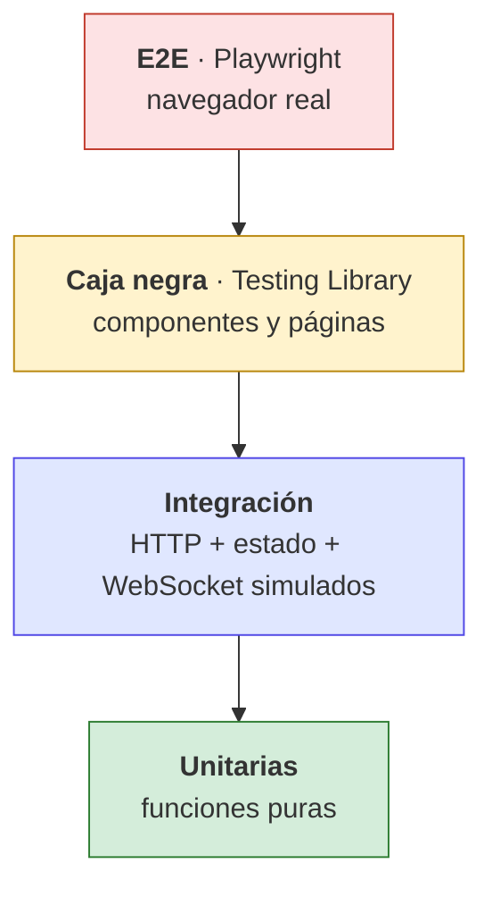
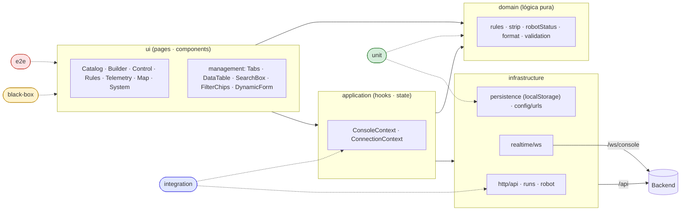

# Pruebas del frontend — velocista-frontend

Estrategia, estructura y ejecución de las pruebas de la consola (React 18 + Vite + TypeScript).
Nombres de archivos y código en **inglés**; los textos que ve el usuario están en **español**
y las pruebas los comprueban tal cual.

> Plan detallado y matriz de trazabilidad: [`PLAN_DE_PRUEBAS.md`](PLAN_DE_PRUEBAS.md)

## 1. Tipos de prueba

| Tipo | Carpeta | Herramienta | Enfoque | ¿Qué valida? |
|------|---------|-------------|---------|--------------|
| Unitaria | [`unit/`](unit/README.md) | Vitest | lógica pura | funciones de dominio, validación, URLs, errores, persistencia local |
| Caja negra | [`black-box/`](black-box/README.md) | Vitest + Testing Library | **caja negra** | componentes y páginas vistos como los ve el usuario (roles, textos, clics) |
| Integración | [`integration/`](integration/README.md) | Vitest + API simulada | caja gris | capa HTTP, estado global y conexión con una API/WebSocket falsos |
| Extremo a extremo | [`e2e/`](e2e/README.md) | Playwright + Chromium | **caja negra** | la consola real en un navegador real, con el backend simulado |

> El profesor pidió que las pruebas del frontend sean de **caja negra**: `black-box/` y `e2e/`
> no inspeccionan estado interno, solo lo que el usuario ve y hace. `unit/` e `integration/`
> apoyan sobre piezas sin interfaz.

## 2. Pirámide



## 3. Qué capa prueba cada tipo



## 4. Estructura

```text
tests/
├── README.md
├── PLAN_DE_PRUEBAS.md
├── unit/
│   ├── domain/            format · robot-status · strip · rules · form-validation
│   ├── infrastructure/    api-errors · urls · persistence
│   └── *.test.ts(x)       pruebas previas del equipo (auth, deployment, refactor…)
├── black-box/
│   ├── components/        management-components
│   └── pages/             catalog-page · pages-smoke (Rules, Builder, Control, Telemetry, Map)
├── integration/
│   ├── http/              api-client (API simulada con paginación y errores)
│   ├── state/             system-connection (health + WebSocket falso)
│   └── *.test.tsx         pruebas previas del equipo
└── e2e/
    └── flows/             *.e2e.ts + _fake-backend.ts
```

## 5. Ejecutar

```powershell
npm install                       # una sola vez
npx playwright install chromium   # una sola vez (solo para e2e)

npm test                  # Vitest: unit + black-box + integration
npm run test:unit
npm run test:black-box
npm run test:integration
npm run test:e2e          # Playwright: levanta `npm run dev` y abre Chromium
```

Antes de subir cambios: `npm run lint`, `npm run typecheck`, `npm run format:check`.

## 6. Convenciones

- Vitest con `globals: false`: importar `describe`, `it`, `expect`, `vi` desde `vitest`.
- Llamar a `cleanup()` en `afterEach` en las pruebas que renderizan.
- Consultar la interfaz **por rol y nombre accesible** (`getByRole`, `getByLabelText`); evitar clases CSS y `data-testid`.
- Nombre del caso: frase corta que describe el comportamiento (`"filters by text ignoring accents"`).
- Archivos E2E terminan en `.e2e.ts` para que Vitest no los ejecute.
- El backend nunca se llama de verdad en estas pruebas: se simula con `fetch`/`WebSocket` falsos o `page.route()`.
- Las pruebas **no** cambian nombres de campos de la API (siguen el contrato en inglés).

## 7. Estado actual

| Tipo | Archivos nuevos | Casos nuevos |
|------|:---------------:|:------------:|
| Unitarias | 8 | 66 |
| Caja negra | 3 | 34 |
| Integración | 2 | 16 |
| E2E (Playwright) | 4 | 6 |
| **Total** | **17** | **122** |

La suite completa de Vitest queda en **163 pasan · 12 omitidas** (las omitidas son `qa-live-stack`, que requiere el stack real levantado).
