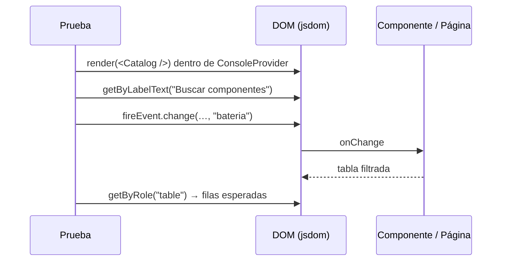

# Pruebas de caja negra (frontend)

Se renderiza un componente o una página y se actúa **como el usuario**: buscar por rol y nombre
accesible, escribir, hacer clic, pulsar teclas. No se lee estado interno ni clases CSS.



## Archivos

| Archivo | Qué comprueba |
|---------|---------------|
| `components/management-components.test.tsx` | `SearchBox`, `FilterChips`, `Tabs` (teclado), `DataTable` (clic/Enter/Espacio), `InputField`, `DynamicForm` |
| `pages/catalog-page.test.tsx` | Catálogo: lista, búsqueda sin tildes, vacío, chips, inventario, registro |
| `pages/pages-smoke.test.tsx` | Reglamento, Armador, Control, Telemetría y Mapa: contenido y acciones principales visibles |
| `pages/_harness.tsx` | `WithConsole` (proveedor con datos de ejemplo) y `stubBrowser()` (APIs que jsdom no tiene) |

## Guía rápida

```tsx
render(<WithConsole><Catalog /></WithConsole>);
fireEvent.change(screen.getByLabelText("Buscar componentes"), { target: { value: "bateria" } });
expect(screen.getByRole("table", { name: "Componentes del catálogo" })).toBeTruthy();
```

- Preferir `getByRole` > `getByLabelText` > `getByText`.
- Las páginas usan `requestAnimationFrame`, `scrollTo` y canvas: llamar `stubBrowser()` en `beforeEach`.

```powershell
npm run test:black-box
```
