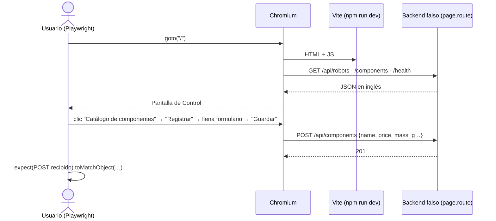

# Pruebas extremo a extremo (frontend)

Playwright abre **Chromium**, carga la consola real (servidor de desarrollo de Vite) y actúa como
una persona. El backend se reemplaza por un servidor falso en memoria (`page.route`) que responde
con el mismo formato de la API real.



## Flujos

| Archivo | Flujo |
|---------|-------|
| `flows/console-navigation.e2e.ts` | arranque con robot y navegación Catálogo → Armador → Reglamento |
| `flows/first-robot.e2e.ts` | club sin robots: mensaje y botón "Crear primer robot" |
| `flows/catalog-view.e2e.ts` | catálogo vacío cargado desde la API |
| `flows/component-registration.e2e.ts` | validación en español y `POST /components` con campos en inglés |
| `flows/_fake-backend.ts` | backend falso reutilizable (`fakeBackend(page, { withRobot, databaseUp })`) |

## Ejecutar

```powershell
npx playwright install chromium   # una vez
npm run test:e2e
npx playwright test --ui          # modo visual para depurar
```

Si Chromium está en otra ruta: `$env:PW_CHROMIUM_PATH = "C:\ruta\chrome.exe"`.

## Cómo agregar un flujo

1. Crear `flows/<flujo>.e2e.ts`.
2. `const backend = await fakeBackend(page);` y, si hace falta, ampliar `_fake-backend.ts` con la ruta nueva.
3. Usar solo selectores por rol/nombre accesible.
4. Verificar tanto lo que **se ve** como lo que **se envía** a la API.
