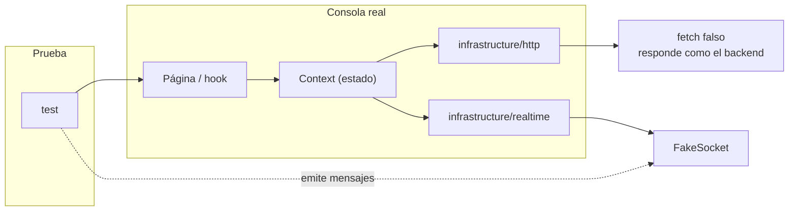

# Pruebas de integración (frontend)

Combinan varias piezas sin salir del proceso: la capa HTTP con una **API falsa**, el estado global con un
**WebSocket falso**. Detectan errores de contrato entre la consola y el backend sin levantar el backend.



## Archivos

| Archivo | Qué comprueba |
|---------|---------------|
| `http/api-client.test.ts` | paginación, mapeo de campos y specs, cuerpos `POST` en inglés, `selection()`, historial sin duplicados, notas, setup/modo/línea, errores de negocio, login y health |
| `state/system-connection.test.tsx` | página Sistema con `ConnectionProvider`: salud de la API, BD, WebSocket y mensajes en vivo |
| `frontend-context`, `run-history`, `real-robot`, `robot-command-errors` | pruebas previas del equipo |
| `qa-live-stack.test.tsx` | previa; **omitida** hasta tener el stack real |

## Patrón de la API falsa

```ts
const calls = fakeApi((url) => ({ body: { items: [...], total: 3, limit: 2, offset: 0 } }));
await api.catalog.list();
expect(calls[0].path).toContain("offset=0");
```

```powershell
npm run test:integration
```
