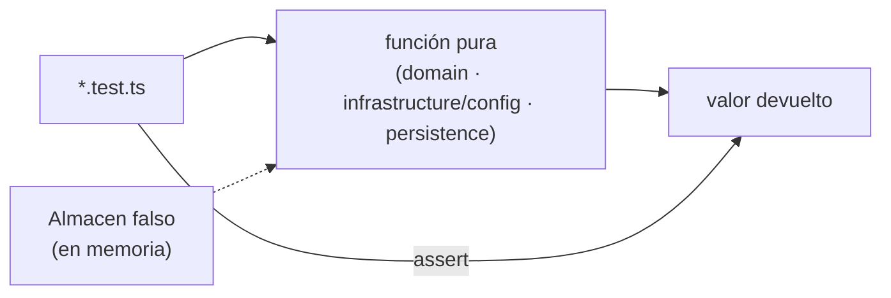

# Pruebas unitarias (frontend)

Verifican funciones **puras** sin React ni red: reglas del armador, estado del robot, regleta,
validación, formato, URLs, errores y persistencia local.



## Archivos

| Archivo | Unidad bajo prueba |
|---------|--------------------|
| `domain/format.test.ts` | `fmt`, `money`, `clamp`, `num`, `clone`, `VERSION_STATUS_LABEL` |
| `domain/robot-status.test.ts` | `robotStatusFromMessages` |
| `domain/strip.test.ts` | `stripFromSignals`, `stripFromMessages` |
| `domain/rules.test.ts` | `byId`, `usedIn`, `usedQty`, `nextComponentId`, `facts`, `saveParts`, `mergeApiRobots` |
| `domain/form-validation.test.ts` | `validateFields`, `parseNumber`, `normalizeText` |
| `infrastructure/api-errors.test.ts` | `toApiError`, `ErrorApi` |
| `infrastructure/urls.test.ts` | `apiUrl`, `consoleUrl` |
| `infrastructure/persistence.test.ts` | `cargarComponentes`, `guardarComponentes`, `borrarRegistrados`, `esComponente` |
| `auth*.test.tsx`, `deployment.test.ts`, `frontend-refactor.test.ts`, `robot-http.test.ts` | pruebas previas del equipo |

## Reglas

- Sin `render`, sin `fetch`, sin temporizadores reales.
- Una función = un `describe`; valores límite con `it.each`.
- Las funciones nunca deben mutar sus argumentos (hay pruebas que lo comprueban).

```powershell
npm run test:unit
```
